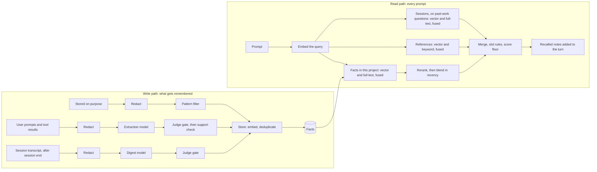

# Architecture

This document describes how the custom build is put together: memory, retrieval, the memory store, the guards and failure handling. It describes the design, not the rules for changing it; those are in [CONTRIBUTING.md](CONTRIBUTING.md). Where the build runs and how it is operated is in [OPERATIONS.md](OPERATIONS.md).

**Status: a design, not yet built.** It is adapted from the Hermes build's architecture (`Custom-Hermes-Agent-Final`). Nothing in this repository implements it yet, and no number in it has been measured here. Sections 3, 4 and 6 carry that design over, because it does not depend on the agent. Sections 1, 2, 5 and 7 are rewritten for Claude Code. Each section is updated to say what was built as its code merges.

Facts about Claude Code itself are stated for **Claude Code 2.1.322**, read from its documentation on 2026-11-17. Re-check them before upgrading Claude Code. A statement marked **[unverified]** was not read from the documentation and is checked before any code relies on it.

**Contents**

1. [Overview](#1-overview)
2. [Entry points](#2-entry-points)
3. [Retrieval](#3-retrieval)
4. [The memory store](#4-the-memory-store)
5. [Guards](#5-guards)
6. [Failure handling](#6-failure-handling)
7. [Logging](#7-logging)

## 1. Overview

The build extends Claude Code through its documented extension points and changes nothing in Claude Code itself, so updates can still be taken.

| Part | Claude Code extension point | What it does here |
|---|---|---|
| Recall | A `UserPromptSubmit` hook, which can add context to a prompt before the model reads it.[1] | Searches memory on every prompt and adds the best notes (section 3) |
| Memory tools | An MCP server, whose tools the agent can call.[5] | Stores a fact and searches memory on demand (sections 3–4) |
| Guards | Hooks on `UserPromptSubmit`, `PreToolUse`, `PostToolUse` and `Stop`.[1] | Force lookups and stop unsafe actions (section 5) |
| Skills | Claude Code skills.[6] | Procedures the agent follows for recurring tasks. The build ships none at first; a skill is added, through a pull request, when a recurring task needs one. |
| Instruction files | `CLAUDE.md`, loaded from the user's home, the project and its subdirectories.[2] | The agent's operating rules. The build's own instruction file is installed at user level and is not loaded from this repository (CONTRIBUTING.md section 9). |

Claude Code's own memory stays on. It is the instruction files above, and auto memory: a directory per project whose `MEMORY.md` is loaded at the start of each session, up to 200 lines or 25 KB.[2] They hold standing rules and preferences. Everything else lives in the memory store.

The build runs on one machine, against one local memory store. Every stored row records the project it belongs to.

**One package.** The hook scripts, the MCP server and the failure module (section 6.1) are one Python package in this repository. A hook is a command Claude Code runs as a new process for each event, with the event as JSON on its standard input; the MCP server is one long-running process per session.[1][5] They share nothing in memory. What they share goes through the memory store or a local state database on the machine (section 2).

Whether the package is installed as a Claude Code plugin or as entries in the user's settings is not decided; OPERATIONS.md section 3 records the choice when it is made.

## 2. Entry points

- **Recall runs inside the prompt hook's deadline.** Claude Code cancels a `UserPromptSubmit` hook after 30 seconds by default, discards its output and sends the prompt on.[1] Recall therefore enforces its own deadline well below that (section 3.6). On failure it adds a "recall failed" note with its failure code instead of exiting with an error, because that is the only way the failure reaches the turn.
- **Every hook gets the session and the directory.** The event carries `session_id`, `transcript_path`, `cwd` and `hook_event_name`, and for a tool event `tool_name` and `tool_input`.[1]
- **The project key comes from the session's working directory.** It is the normalised URL of the `origin` remote of the repository that `cwd` is in, so it is the same on every machine. An absolute path is never used, because it differs between machines. A directory that is not a repository has no project, and neither has a repository whose `origin` is missing, a local path or a file URL.
- **A hook that fails lets the action through, unless the build makes it block.** When a hook crashes, times out, exits with a code other than 0 or 2, or prints invalid output, Claude Code carries on with the action. Exit code 2 blocks on `PreToolUse`, `UserPromptSubmit` and `Stop`.[1] So every entry point goes through one boundary wrapper in the failure module. On an unexpected exception it records the failure, with its traceback in the log (section 6.1), then does what that entry point requires:

  | Entry point | Recorded as | Then |
  |---|---|---|
  | A guard on `PreToolUse`, in `on` mode | `guard.crash` | Denies the call, naming the failure |
  | A guard on `UserPromptSubmit`, in `on` mode | `guard.crash` | Blocks the prompt, naming the failure |
  | A guard on `Stop`, in `on` mode | `guard.crash` | Blocks the stop once, naming the failure; when `stop_hook_active` is already true it lets the turn end, so a guard that keeps crashing cannot loop |
  | A guard in `log` mode, on any hook | `guard.crash` | Exits 0, so the action goes ahead: `log` mode blocks nothing (section 5.4) |
  | Recall on `UserPromptSubmit` | `unhandled` | Adds a "recall failed" note; the prompt goes ahead |
  | An MCP tool handler | `unhandled` | Returns a tool error that names the failure |
  | `PostToolUse`, `SessionStart`, `SessionEnd`, `PreCompact` | `unhandled` | Exits non-zero. These events cannot block, so they record and never enforce. |

  This wrapper, and the job wrapper (section 6.1), are the only code allowed to catch everything (CONTRIBUTING.md rule C2).
- **The wrapper's own deadline comes before Claude Code's.** A hook Claude Code cancels at its timeout renders no decision, so the call goes ahead.[1] Each enforcing guard therefore has a deadline of its own, shorter than the `timeout` set for it in the settings, and answers with a block when it passes. The hooks reference also describes an `onFailure: "block"` option for a hook; whether to rely on it as well is decided when the first guard is built. **[unverified]**
- **A memory tool that fails is a tool error, never an empty result.** A failure the tool expects, such as a missed deadline or an unreachable store, is returned as an error that carries its code (CONTRIBUTING.md rule C3). No guard counts it as a lookup (section 5.3).
- **Local state.** A hook process ends when it answers, so what a guard keeps between calls, such as its record of what a session has read, lives in a SQLite database under the build's state directory on the machine, keyed by `session_id`. Nothing is written into the package's own directory or into Claude Code's settings.
- **Session end is too short to work in.** `SessionEnd` hooks share a 1.5-second budget.[1] The hook only queues the session's `transcript_path` in the local state database. The digest (section 3.3) is written from the queue, off the turn's path.
- **Subagents run the hooks too.** Hooks from settings run inside subagents,[1] so the guards apply there. Whether recall and extraction should run for a subagent's prompt is an open question (section 5.6).
- **Open: mirroring Claude Code's own memory.** Whether a write to auto memory or to a `CLAUDE.md` is mirrored into the store as a deliberate fact, and from which event, is not decided. **[unverified]**

## 3. Retrieval

The model keeps nothing between turns except Claude Code's own memory files. Every prompt triggers a search, and the best results are added to the turn before the model reads it. A separate write path decides what is stored.



### 3.1 The stores

| Store | What it holds | How it is searched |
|---|---|---|
| Claude Code's own memory | Standing rules and preferences | Not searched. It is in every session's context.[2] |
| Facts | Short facts and decisions, and one digest per long session | By meaning and by exact words, then reranked |
| Sessions | What was said in past conversations in the last 90 days, cut into chunks | By meaning and by exact words, on questions about past work |
| References | Long write-ups and procedures; none at first | By meaning and by exact words |

Facts go in the facts store. Long procedures and write-ups are references. What was said is in sessions. How to do a task is a skill.

The sessions store is built only after the eval set (section 3.8) shows it adds recall over the facts store alone, and is kept only while it does. There are no references at first: that store is added when there is a set of documents to search.

### 3.2 Embedding

- **One model for every store.** Facts, chunks and queries are all embedded by `Qwen3-Embedding-4B` at its native 2,560 dimensions, so their vectors are comparable.
- **One pinned build.** The model build is pinned by its digest and recorded with every vector (`embedding_model`), written `qwen3-embedding:4b@sha256:<digest>` from Ollama's list of local models. A machine whose build differs refuses to run recall (`embed.model_mismatch`). A vector from a different build is never stored. The store's build is the one its facts record, so an empty store records none until its first fact. The provider checks when it starts, and its embedder checks again before embedding until a check has passed, so a failed check refuses every embedding and a later pass recovers.
- **Storage.** Vectors are stored as `halfvec(2560)` with an HNSW cosine index. At this size the half-precision type is required: an HNSW index supports `vector` only up to 2,000 dimensions and `halfvec` up to 4,000. Indexing `halfvec` needs pgvector 0.7.0 or later.[7]
- **Query instruction.** Queries are prefixed with the task instruction the model card recommends; documents are embedded without one.[8] It becomes the default only after the eval set shows the gain.
- **What is embedded.** A fact is embedded once, when it is stored. Reference and session text is cut into chunks of about 800 characters. Each chunk is prefixed with its origin: the file and heading for a reference, the user's message for a session reply.
- **Caching.** A query is embedded once per turn and reused by every store.
- **No substitute model.** If the embedding service is unavailable, search fails with `embed.unavailable` and new facts are refused.

### 3.3 The write path

1. **Three entrances.**
   - The agent stores a fact on purpose, with the MCP server's `store_fact` tool, saying what it rests on.
   - An extraction model reads the user's prompts and tool results (command output, file contents, documentation lookups) and proposes facts. It never reads the agent's own replies, because a wrong reply would otherwise be recalled later as a known fact. Which event starts it, and through which route the model is called, are decided when it is built. A call the provider refuses for the account is `extract.refused`; any other failure, or an answer that is not a list of facts, is `extract.error`.
   - A digest model writes a digest of each long session (section 3.6) from its queued transcript (section 2). A session keeps one live digest: a later one replaces the earlier one. It reads the redacted transcript, without system prompts, and answers with a summary and the work left open, stored as the summary followed by an "Open items:" list. Its basis is `assistant_inferred`, since the transcript holds the agent's replies (rule 6), and it is never compared with facts, so it supersedes only its own session's earlier digest. A refused call is `digest.refused`; any other failure is `digest.error`; a digest the judge did not keep is `digest.dropped`, which is not a failure.
2. **Redaction before any model sees the text.** The prompt, the tool output and the session transcript are redacted before they reach the extraction, digest or judge model, and before anything is stored (CONTRIBUTING.md rule L4). If redaction fails, nothing is sent or stored (`redact.failed`).
3. **A filter on each.**
   - A fact stored on purpose passes a pattern filter: it must meet the minimum length and must not match the narration patterns in the write-path configuration file, which also holds section 3.6's supersede thresholds and the wording of the judge's questions.
   - Extracted facts and digests go to a judge model, which drops the ones not worth keeping.
   - An extracted fact then gets a separate check: does its source turn support it? A fact its source does not support is not stored.
   - If the judge errors, the fact is queued for retry, never stored unchecked (`store.gate_error`). It waits, redacted, in the local state database (section 2); a retry that resolves a fact is recorded as `store.gate_error` with the result `degraded`.
4. **One store function.** Every entrance then goes through one function. It embeds the text and compares it with what is already stored in the same project. "Short" and "long" are defined in section 3.6.

   | Match with an existing fact | Result |
   |---|---|
   | Identical text | Not inserted |
   | Very close in meaning, short text | The new fact supersedes the old one |
   | Very close in meaning, long text, or somewhat close in meaning | The judge decides whether it is the same subject and whether the new fact supersedes the old |

5. **Origin protects deliberate facts.** A fact stored on purpose can supersede an extracted one. The reverse is never allowed.
6. **Every fact records its basis and source.** `basis` is `user_stated`, `tool_observed` or `assistant_inferred`; `source_turn` points to the turn it came from. A digest takes the weakest basis of its inputs, so a summary never turns an inferred claim into a stated one. Recalled notes show the basis.
7. **Nothing is silently lost.** A superseded or retired fact stays in the table, marked, with a pointer to its replacement or the reason it was retired.

### 3.4 Retrieval

Retrieval is hybrid, with a rerank stage. A search by meaning and a search by words each produce a ranked list, fused by rank position (reciprocal-rank fusion). A row found both ways usually ranks above a row found one way, but not always: a row ranked low in both lists can score below a row ranked first in one.

| Store | By meaning | By words | Fusion | Rerank |
|---|---|---|---|---|
| Facts | Cosine distance over vectors | Postgres full-text, any of the query's words | Rank fusion, inside one SQL function | Yes |
| References | Cosine over chunks | BM25 over the same chunks, in application code | Rank fusion | No |
| Sessions | Cosine over chunks | Postgres full-text | Rank fusion | No |

For the facts store:

1. Embed the query.
2. Fetch a candidate pool larger than the number of results wanted, from live rows in the current project and live rows with no project. A session with no project searches live rows in every project.
3. Fuse the two ranked lists. Steps 2 and 3 are one SQL function, which runs as its caller, under the caller's grants and row policies.
4. Rerank the pool with the judge model, under the judge deadline (section 3.6). One request carries the user's prompt as state and one probability question per candidate, each with the candidate's own text; each result records `ranked_by: judge` and its score. If the judge errors or misses that deadline, the pool keeps its fused order and the result is recorded as degraded (`rerank.fallback`), never as a silent success; the notes are still delivered. No local reranker is kept as a fallback.
5. Blend recency back in, on a reranked pool only. A rerank score ignores age, so the final score adds a recency term from `last_verified_at`, or `created_at` for a fact never checked.[9] Its weight is set by the eval set.
6. Return the top results. Each result records which searches found it and which stage ranked it.

**Filtering and the vector index.** pgvector applies `WHERE` conditions after the HNSW scan, so a filtered search can return fewer rows than asked for.[10] The search functions set `hnsw.iterative_scan = relaxed_order` (pgvector 0.8.0 and later). The write path's lookup of the one nearest fact (section 3.3) sets `strict_order`, because it reads only the top row and needs the truly nearest one. The facts index is partial, over live rows only, and queries repeat that predicate exactly so the planner uses it.

**Word queries.** The full-text side joins the query's words with OR and ranks with `ts_rank_cd`. `plainto_tsquery` and `websearch_to_tsquery` both join unquoted words with AND, so with either one a long question matches nothing.[11] Postgres full-text ranking is not BM25: it uses no statistics from the rest of the collection.[11] BM25 for references therefore runs in application code.

### 3.5 Delivery

1. **Every prompt is searched.** Only an empty prompt is skipped.
2. **Two searches can run in the prompt hook**, once the action query is switched on; until then only the prompt query runs:
   - **The action query.** One request, the routing request, goes to the judge model with the user's prompt and the end of the assistant's previous reply, read from the transcript. The judge answers two typed questions, each with a probability: which kind of work from a fixed action list the prompt asks for, and whether it asks for work at all. The facts store is searched with the picked action's description. It ships switched off, and is switched on only once the eval set has measured it. A skipped action query is recorded under its own event name, `action.skipped`, so it cannot be mistaken for one that ran and found nothing, which is recorded as `empty`. Its notes carry a header of their own.
   - **The prompt query.** It searches the user's words across the stores, under the recall deadline.
3. **Questions about past work widen the search.** They fetch more results and add past sessions, once that store exists. A question about past work is one that the recall gate's patterns match (section 5.3), so the search and the gate always agree on it.
4. **"What is left to do?" adds the newest open items to the search.** A question about open work gets the newest digests' open items for the current project, newest first, because such a question has few topic words to match and its answer depends on recency. They are added before the normal search's notes, not instead of them. A pattern that misfires on an ordinary prompt then only adds a few notes.
5. **Slot rules keep the mix fair.** The merge drops reranked facts under the score floor, then applies a cap on digests, reserved places for references and the cut to the number of results per prompt (section 3.6). The floor applies only where the score is a probability: the judge's rerank score for a fact. Results ranked by fusion alone have no floor and are cut by rank only.
6. **Results are added to the prompt** through the hook's `additionalContext`,[1] as recalled notes, labelled as notes and not as instructions. Each note shows its origin, its basis, the date it was stored and, when checked since, the date it was last verified. The store cancels the search's statements at the recall deadline, so a stalled store cannot hold a connection open; the turn is told `recall.timeout`.
7. **The agent can also search on demand** with the memory search tool.

A recall that fails or misses its deadline is reported in the turn with its failure code. It is never presented as "no notes found".

### 3.6 Defaults

These are configuration values, carried over as starting values. Change one through an issue, with eval-set numbers from before and after (CONTRIBUTING.md rule C8).

| Setting | Default |
|---|---|
| Chunk size | 800 characters; 100 shared between neighbouring session chunks |
| Rank-fusion constant | 20 for facts and references, 60 for sessions |
| Candidate pool for facts | Three times the results wanted, at least 15 |
| Short text, long text | Short is 300 characters or fewer; long is anything longer |
| Long session (gets a digest) | 20 messages or more |
| Minimum fact length | 10 characters |
| Supersede without the judge | Cosine similarity 0.92 or higher, short texts only |
| Ask the judge | Cosine similarity from 0.80 up to 0.92, or 0.92 and higher for long texts. The judge returns two probabilities, "same subject" and "the new fact supersedes the old"; both must be 0.75 or higher. |
| Judge gate | Drops at a drop score of 0.70 or higher: 1 minus the judge's probability that the fact is worth keeping |
| Support check (extracted facts) | Kept only when the judge's probability that its source turn supports it is 0.75 or higher. A starting value; the eval set confirms or changes it. |
| Results per message | 5; 8 on a question about past work; 3 for the action query |
| Digests per message | At most 1 among the search's notes; the rest are facts. A question about open work also carries open items from up to 3 digests, each item a note of its own (3.5 point 4). A starting value; the eval set confirms or changes it. |
| Digests read for "what is left to do?" | The project's newest 3. Their open items come first and fill the 8 results beside the search's 5. A starting value; the eval set confirms or changes it. |
| Score floor | 0.30, on facts the judge reranked, where the score is the judge's probability that the fact helps answer the message: under 0.3 reads as no, as in the "Asks for work at all" row. No floor on results ranked by fusion alone. A starting value; the eval set confirms or changes it. |
| Recall deadline (the prompt hook) | 6 seconds |
| Action query (section 3.5) | Off, until the eval set has measured it |
| Judge deadline (one rerank or routing request) | 2 seconds. A starting value, not yet timed here. |
| Previous reply sent with the routing request | Its last 500 characters |
| "Asks for work at all" (section 3.5) | A probability under 0.3 is a clear no, and the action query is skipped. Anything higher runs it. A starting value; the eval set confirms or changes it. |
| Recency weight | Set by the eval set |
| Recalled-note budget | Set by the eval set |

How much context one hook may add to a prompt is read from the hooks reference before the recalled-note budget is set. **[unverified]**

### 3.7 What leaves the machine

Every deployment states this in its own documentation:

- Stored facts, digests, session chunks and events go to the memory database, which keeps session chunks and events for 90 days (section 4.3).
- Search candidates go to the judge model with the user's prompt, redacted, for the rerank. Candidate facts go with their source turn for the gate and the support check, and each new fact with the stored fact closest to it, when the judge decides whether one supersedes the other (section 3.3).
- Each user prompt, with the end of the assistant's previous reply, goes to the judge model for routing (section 3.5) when the action query is switched on.
- User prompts and tool output go to the extraction model, redacted, never the agent's replies.
- Session transcripts go to the digest model, redacted, without system prompts.
- The daily failure report is a file on the machine and is sent nowhere.

Secrets are redacted before anything is stored or sent.

### 3.8 The eval set

No ranking change ships without numbers from the eval set.

- It starts from LongMemEval-S, which covers information extraction, multi-session reasoning, temporal reasoning, knowledge updates and abstention.[12]
- It grows from real misses found in the `events` table: open-work questions answered badly, notes from the wrong project, recall that found nothing, and questions whose correct answer is "no note". A miss is promoted by copying it into the eval set; the `events` row itself is not kept.
- LongMemEval-S is not committed: its data file is about 280 MB. The eval runner downloads the cleaned release's S file at a pinned revision and checks it against a recorded hash before it runs. It is MIT-licensed.[14]
- The rest of the eval set lives in this repository as data files, reviewed through pull requests like code. A question copied from a real miss is reworded so that it holds no deployment values (CONTRIBUTING.md section 3).
- Reports give recall@5, MRR and an abstention score.
- The eval set runs against its own throwaway Postgres, on the pinned embedding build. It never touches the live store (OPERATIONS.md section 2).
- The runner replays the whole build: for each question it drives the write path over the question's chat history, asks the question through recall, and scores the notes. The Hermes build's runner does this for its own provider; how much of it is shared is decided when this build's runner is written.

## 4. The memory store

The memory store is Postgres with the `pgvector` extension. It holds the facts, the session chunks and the events, and runs the hybrid search inside SQL functions. It is the local `claude_mem` database that the pack this build replaces already uses. The build's tables live in a schema of their own, `memory`, beside that pack's tables, which this repository did not create and never alters (CONTRIBUTING.md rule C7). The existing facts are copied in once, at the cutover (OPERATIONS.md section 8).

### 4.1 Design rules

1. **One meaning for each column.** What a row is, where it came from, which project and session it belongs to and which machine wrote it are columns, never tags or fields in a shared blob.
2. **The lifecycle is in the database.** Each fact records when it was last verified and what superseded it. Search reads only live rows, so a stale fact cannot look like a current one.
3. **Nothing is hard-deleted by the agent.** A fact is superseded, with a pointer to its replacement, or retired, with a reason. The row stays.
4. **Every vector records the build that made it.** A change of embedding model is a visible migration, not a silent mismatch.
5. **Nothing unused.** No column, index or function argument exists without code that reads it.
6. **Any machine can write a session chunk.** A chunk is identified by its source, session, the message's id and its chunk number, never by a row id or a position. Rows carry Claude Code's `session_id`. Still open: when Claude Code changes a session's id (a resume, a compaction, a clear), and which stable id a message in the transcript carries. Both are read from the documentation and a transcript before the sessions store is built. **[unverified]**

### 4.2 Schema

This section is the plan. Each table's migration file becomes its source of truth when it merges, and this section is updated to match.

```sql
create extension if not exists vector;
create schema memory;   -- the build's own schema, beside the earlier pack's tables

create table memory.facts (
  id               uuid primary key default gen_random_uuid(),
  body             text not null,
  body_hash        text not null,            -- hash of the normalised body, for the identical-text check
  kind             text not null check (kind in ('fact', 'digest')),
  origin           text not null check (origin in ('explicit', 'extracted', 'digest', 'imported')),
  basis            text not null check (basis in ('user_stated', 'tool_observed', 'assistant_inferred')),
  project          text,                     -- project key (section 2); null when the session had none
  source           text not null,            -- the machine that wrote the row
  session_id       text,
  source_turn      integer,                  -- the session's user-turn number the fact came from
  embedding        halfvec(2560) not null,
  embedding_model  text not null,            -- model name and build digest
  search_text      tsvector generated always as (to_tsvector('english', body)) stored,
  created_at       timestamptz not null default now(),
  last_verified_at timestamptz,
  superseded_by    uuid references memory.facts (id),
  retired_at       timestamptz,
  retired_reason   text,
  check ((retired_at is null) = (retired_reason is null)),
  check ((kind = 'digest') = (origin = 'digest'))
);

create unique index facts_live_body_hash on memory.facts (project, body_hash) nulls not distinct
  where superseded_by is null and retired_at is null;
create index facts_live_embedding_idx on memory.facts using hnsw (embedding halfvec_cosine_ops)
  where superseded_by is null and retired_at is null;
create index facts_search_text_idx on memory.facts using gin (search_text);
create index facts_session_idx on memory.facts (session_id);   -- the digest job checks for an existing digest
-- one live digest per session, checked at commit so the build's insert-then-supersede still passes
alter table memory.facts add constraint facts_one_live_digest_per_session
  exclude using btree (session_id with =)
  where (kind = 'digest' and superseded_by is null and retired_at is null)
  deferrable initially deferred;

create table memory.transcript_chunks (
  id               uuid primary key default gen_random_uuid(),
  source           text not null,            -- the machine that wrote the session
  project          text,
  session_id       text not null,
  message_uid      text not null,           -- the message's stable id (open: section 4.1)
  chunk_no         smallint not null,
  body             text not null,
  embedding        halfvec(2560) not null,
  embedding_model  text not null,
  search_text      tsvector generated always as (to_tsvector('english', body)) stored,
  created_at       timestamptz not null default now(),
  unique (source, session_id, message_uid, chunk_no)
);

create index transcript_chunks_embedding_idx on memory.transcript_chunks using hnsw (embedding halfvec_cosine_ops);
create index transcript_chunks_search_text_idx on memory.transcript_chunks using gin (search_text);
create index transcript_chunks_created_at_idx on memory.transcript_chunks (created_at);   -- the retention job deletes by age

create table memory.events (
  id          bigint generated always as identity primary key,
  at          timestamptz not null default now(),
  source      text not null,                 -- the machine
  project     text,
  session_id  text,
  turn        integer,
  code        text not null,                 -- a code from the failure catalog, or an event name
  result      text not null check (result in ('ok', 'empty', 'failed', 'degraded')),
  reason      text,
  detail      jsonb not null default '{}'    -- IDs, scores, counts and hashes only; never content
);

create index events_at_idx on memory.events (at);
create index events_code_idx on memory.events (code, at);
```

| Column | Meaning |
|---|---|
| `kind` | A single fact, or a digest of a session |
| `origin` | Who wrote it: stored on purpose, extracted, written by the digest job, or imported |
| `basis` | What it rests on: the user said it, a tool showed it, or the agent inferred it |
| `project`, `source` | The project it belongs to, and the machine that wrote it |
| `last_verified_at` | When the fact was last checked against the live system |
| `superseded_by` | The fact that replaced this one. Empty on a live row. |
| `retired_at`, `retired_reason` | Set together when a fact is withdrawn without a replacement |
| `embedding_model` | The model and build that produced the vector |
| `events.result` | `ok`, `empty` (searched, found nothing), `failed`, or `degraded` (a fallback or a retry succeeded) |

The `source` column is carried over from the Hermes design. With one machine it is constant, so whether it stays is decided when the first migration is written (rule 5 above).

Two SQL functions do the searching: one for facts and one for session chunks, which arrives with their table. Each runs the vector and full-text searches and fuses them. The facts search reads live rows only; session chunks have no lifecycle, so their search reads every chunk.

### 4.3 Access and migrations

- **The build connects with a role that cannot delete.** That role can read, insert into the tables code writes to, and update only the columns that take updates. It cannot delete rows or create, alter or drop anything. The privileges belong to two group roles that the migrations create and that cannot log in: `memory_agent`, which the build's login role joins, and `memory_maintenance`, which only the retention job's login joins. Login roles and their passwords are created outside the repository (OPERATIONS.md section 3).
- **Row Level Security is on for every table, as a backstop.** With RLS on and no policy, Postgres denies every row to a role that does not own the table, so each machine's role gets an explicit select policy on every table, insert policies on the tables code writes to, update policies only on tables that take updates, and no delete policy.[13]
- **Schema changes are migration files in this repository**, reviewed through a pull request. Migrations only move forward; an applied migration is never edited. The store records the number of the newest migration applied in a one-row table, and the build carries the number it was built against; the startup check compares the two (section 5.5).
- **Data this repository did not create is not ours to change** (CONTRIBUTING.md rule C7). An export exists before any migration touches data.
- **Retention.** `events` rows and session chunks are deleted after 90 days by a scheduled job on the machine that connects with the maintenance role, so the role the agent's session uses can never delete. Each run records `job.succeeded` naming `retention`; a missing one is reported as `job.missed` by the job-health check (OPERATIONS.md section 4). Facts and digests are kept.

## 5. Guards

### 5.1 The principle

A rule in a prompt only asks. The model can skip a lookup that a prompt requests, and nothing visible happens when it does. A guard makes the skipped lookup fail where it can be seen. Every behaviour this project depends on is backed by a guard, or it is treated as a request the model may ignore.

### 5.2 The hook points

| Hook | When it runs | What a guard does there |
|---|---|---|
| `UserPromptSubmit` | Once per prompt, before the model reads it | Classifies the prompt and adds a reminder to it. It can also block the prompt. |
| `PreToolUse` | Before each tool call | Checks the call. It can deny it, or send it to a person with `permissionDecision: "ask"`. |
| `PostToolUse` | After a tool call succeeds | Records what ran. The tool has already run, so it can record but not enforce. A failed call fires `PostToolUseFailure` instead, so it is never counted as a lookup. |
| `Stop` | When the model is about to end its turn | Blocks the stop with a reason, which sends the model back to do the lookup it skipped. |

All four are as the hooks reference describes them.[1]

**The reply cannot be withheld.** The Hermes build holds a reply back until its guard has run. Claude Code's `Stop` hook runs after the reply has been shown; blocking it continues the conversation, it does not take the reply back. So here the user can see an unchecked reply, followed by the model being sent back and a corrected one. The guard's notice says the first reply was not checked.

### 5.3 The guards

| Guard | Acts when | What it forces |
|---|---|---|
| Fact gate | The user asks a checkable question | At least one lookup tool in that turn, or the stop is blocked. A reply that gives a vendor procedure or a diagnosis also needs a documentation lookup. |
| Recall gate | The user asks about past work | A memory search in that turn, or the stop is blocked. |
| Verify gate | A tool call would change a managed file or setting | The session must have read it first, or the call is denied. |
| Write gate | A tool call matches the list of sensitive actions | A human approval. With nobody to answer, the call is denied. |

What counts as a checkable question, a question about past work, a managed file or setting, a lookup tool and a sensitive action is defined in each guard's configuration file in this repository, as patterns and lists. Changing one is a pull request like any code change, with the guard's tests updated. The first lists are written when each guard is built, from an inventory of what the current setup guards; none is fixed here.

- **A lookup counts only from `PostToolUse`**, which fires for a call that succeeded, including calls inside a batch.
- **The write gate asks through Claude Code's own permission prompt**, by answering `ask` from `PreToolUse`. A hook's `ask` or `deny` still applies in `bypassPermissions` mode.[3] What happens to an `ask` when nobody can answer, in a run started with `-p`, is not stated on the pages read; the setting `permissions.denyInsteadOfPrompting` exists for it. The gate's behaviour there is tested before it is relied on. **[unverified]**
- **Each event names what was matched and no more:** the listed path, or the program and verb a command pattern matched. The rest of a command is not stored, because an argument can be a credential that no redactor knows.

### 5.4 How a guard is built

1. **Detect from the input, cheaply.** A pattern match on the prompt decides before the model answers. No model judgment is involved.
2. **Remind in the turn**, and keep the requirement in front of the model until it is met.
3. **Count the tool by name once it has run.**
4. **Enforce.** Deny the call, or block the stop.
5. **Record every decision.** Each arm, deny, block and approval is logged and written to `events`.
6. **Ship in log mode first.** Each guard has three modes: `on`, `log` (detect and record only) and `off`, set in the guard's configuration file in this repository, so a mode changes only through a reviewed pull request. A guard moves from `log` to `on` after a week of real use; its pull request cites the guard's counts from `events`, with the triggers the maintainer judged false.

### 5.5 Failure behaviour

- **Claude Code fails open, so the build fails closed itself.** A hook that crashes, times out or prints invalid output does not stop the action.[1] Every enforcing guard goes through the boundary wrapper (section 2), which records `guard.crash` and answers with a block, and keeps its own deadline below the hook's timeout.
- **Nothing can refuse to start a session.** `SessionStart` has no blocking or decision control.[1] The startup check therefore runs there to record and to warn: it adds a notice to the session's context and writes its failure code. It checks that:
  - the build's settings are present and valid (`config.missing`): the machine's name and the store's connection string;
  - Claude Code's settings have the values the build depends on (`config.unsafe`): every guard's hook is registered, and `disableAllHooks` is not set;
  - the store is at the migration the build was built against, or a later one (`db.behind`);
  - the machine's name is the name of the login the store sees.
- **A missing setting blocks the prompt.** The `UserPromptSubmit` hook checks the build's settings on every prompt. When one is missing or invalid, it blocks the prompt with a notice that names the setting (`config.missing`), so the agent never runs a turn with the build half configured.
- **Each guard finishes fast.** Each keeps its whole run, network calls included, under 10 seconds, and writes its events off the answer's path, so a store that stops answering cannot hold a tool call open.

### 5.6 Known limits

- Detection is by pattern. A question phrased outside the patterns gets no reminder, no wider search and no open-items answer.
- A lookup check proves that a lookup happened, not that it was the right one.
- A reply is shown before the `Stop` guard runs (section 5.2).
- **Hooks can be switched off, and then no guard runs and nothing records it.** The setting `disableAllHooks`, a managed `allowManagedHooksOnly`, and a session started with `--bare`, which skips hooks, MCP servers and `CLAUDE.md`, each do this.[1][4] Such a session writes no events, and nothing catches it yet. Whether it can be recorded after the fact, as the Hermes build's `guard.bypassed` is, is open.
- A deny rule or a command pattern matches the command text. The same program called in another form, or a script that writes a file through its own code, is not seen.[3]
- Hooks run inside subagents.[1] Whether the fact gate and the recall gate should arm on a subagent's prompt, and how a subagent's lookups count for its parent's turn, is decided when those guards are built. Any exemption is written down here, because an exempt path produces unguarded claims.
- A person's earlier "always allow" answer covers later calls the same rule matches, and the write gate does not see the answer itself. **[unverified]**

## 6. Failure handling

Every point of failure has a name, and a failure, an empty result and a fallback can always be told apart. The rules are F1–F6 in CONTRIBUTING.md; this section describes the mechanism.

### 6.1 The failure catalog

The catalog is one module in the package. It lists every failure code, with each code's severity (high, medium or low) and whether the build shows it in a turn; the daily report prints both. The catalog also lists the events that are not failures, such as `job.succeeded`, because the recording helper takes only codes in the catalog (CONTRIBUTING.md rules L3 and F6). A test fails the build if any handler or fallback emits a code that is not in it, or emits none, or if a code has no severity.

Two wrappers in the same module record what no handler caught. The boundary wrapper covers every entry point Claude Code calls (section 2). The job wrapper covers every scheduled job and the startup check: on an unexpected exception it records `unhandled` and `job.failed`, then exits non-zero. These two wrappers are the only code allowed to catch everything. Both log the traceback; the `events` row carries only the exception's type and message as its reason, because a traceback can carry content (CONTRIBUTING.md rule L5). A message can carry a secret too, so the reason passes through the redactor before it is stored (rule L4); if the redactor raises, the row carries the type alone.

Starting codes, carried over. A code is added to the module with the code that emits it:

| Code | Raised when |
|---|---|
| `embed.unavailable` | The embedding service cannot be reached |
| `embed.model_mismatch` | This machine's embedding build differs from the one recorded in the store |
| `db.unreachable`, `db.auth`, `db.query` | The memory store cannot be reached, refuses the role, or rejects a query |
| `db.behind` | The startup check found the store behind the migrations the build needs (section 5.5) |
| `recall.timeout` | Recall misses its deadline |
| `judge.timeout`, `judge.error` | The judge model times out or errors |
| `rerank.fallback` | The judge could not rerank, and the pool kept its fused order (degraded) |
| `action.skipped` | Not a failure: the action query was skipped, because the judge read the message as asking for no work (section 3.5) |
| `store.gate_error` | The judge failed during a write; the fact is queued |
| `extract.error` | The extraction model failed or answered something other than a list of facts |
| `extract.refused` | The extraction model's provider refused the account: logged out, billing, or forbidden |
| `digest.error` | The digest model failed or answered something other than a digest |
| `digest.refused` | The digest model's provider refused the account: logged out, billing, or forbidden |
| `digest.dropped` | Not a failure: a session's digest was not stored, because the judge did not keep it or a later or concurrent digest of the session is live |
| `guard.bypassed` | A session was found to have run with the hooks off. Whether this can be detected after the fact is open (section 5.6) |
| `guard.crash`, `guard.not_loaded` | A guard raised during a turn (recorded instead of `unhandled`), or the startup check found a guard's hook not registered |
| `write_gate.would_ask`, `write_gate.would_block` | Not failures: in `log` mode, the write gate saw a call on its list that `on` would send to a person for approval, or would block outright (section 5.3) |
| `verify_gate.would_block`, `verify_gate.would_withhold` | Not failures: in `log` mode, a call would change a listed file or setting the session never read, or a reply stated a listed file's contents the session never read (section 5.3) |
| `fact_gate.armed`, `fact_gate.would_withhold`, `fact_gate.passed` | Not failures: in `log` mode, the user asked a checkable question; its reply had no lookup, or gave a procedure or diagnosis with no documentation lookup; or its reply came with the lookups asked for (section 5.3) |
| `recall_gate.armed`, `recall_gate.would_withhold`, `recall_gate.passed` | Not failures: in `log` mode, the user asked about past work or open work; the reply came without both the memory search and the session search; or it came with both (section 5.3) |
| `config.unsafe` | The startup check found a Claude Code setting with a value the build does not support (section 5.5) |
| `config.missing` | A setting the build needs is missing or invalid: the startup check warns, a scheduled job stops, and every prompt is blocked (section 5.5) |
| `redact.failed` | The redactor raised; the text is not stored or sent |
| `events.write_failed` | An `events` row could not be written; logged locally at ERROR |
| `job.failed`, `job.missed`, `job.no_output` | A scheduled job failed or the startup check crashed; a scheduled job did not run, or took input and produced nothing |
| `job.succeeded` | Not a failure: a scheduled job's run finished. Its `detail` names the job as `job` and, where the job has them, its counts as `input` and `output`; the job-health check reads those three keys (section 6.3) |
| `unhandled` | Anything not in the catalog, outside a guard. Recorded by the boundary wrapper or the job wrapper, with its traceback in the log. |

### 6.2 Where a failure appears

| Place | What appears |
|---|---|
| The build's log file | Every occurrence, at WARNING or above |
| `events` table | Every occurrence, with its code, result and reason |
| The turn | A short notice, when the failure changed the answer |
| The daily failure report | Every failure of the day, grouped by code |

A retry that succeeds is recorded as `degraded` with its retry count, so a flaky dependency shows up as a trend before it becomes an outage.

### 6.3 Absence checks

Some failures raise nothing. A daily check flags any scheduled job with no `job.succeeded` event in the last 24 hours (`job.missed`), and any job that processed input but produced no output for more than one run (`job.no_output`). The daily report is itself checked by its absence: a day with no report is treated as a failure (OPERATIONS.md section 4). A session whose hooks are off writes no events at all, and nothing here catches that yet (section 5.6).

## 7. Logging

Claude Code does not own logging for the build. A hook is a separate process whose stdout and stderr Claude Code reads as the hook's answer, and an MCP server speaks its protocol over stdout.[1][5] So the build logs to a file of its own:

- **One rotating log file per machine**, in the build's state directory, set up by one function in the failure module.
- **Redaction.** Every line passes through the build's redactor, and so does every value before it is written to the store or sent off the machine. The redactor's patterns are the build's own, with a test for each key format it must catch.
- **Structure.** Each event is one line whose message is a single JSON object, written by one helper in the failure module that both logs the line and writes the `events` row, so the two always use the same fields.
- **Durability.** Logs rotate and live on one machine. Decisions and failures also go to `events`, which outlives the log.

Claude Code's own debug output (`--debug`, `--debug-file`) is separate and is not where the build's failures are read.[4]

The rules are L1–L5 in CONTRIBUTING.md.

## Sources

- [1] [Hooks reference (Claude Code documentation)](https://code.claude.com/docs/en/hooks)
- [2] [How Claude remembers your project: CLAUDE.md, AGENTS.md and auto memory (Claude Code documentation)](https://code.claude.com/docs/en/memory)
- [3] [Configure permissions (Claude Code documentation)](https://code.claude.com/docs/en/permissions)
- [4] [CLI reference (Claude Code documentation)](https://code.claude.com/docs/en/cli-reference)
- [5] [Connect Claude Code to tools via MCP (Claude Code documentation)](https://code.claude.com/docs/en/mcp)
- [6] [Extend Claude with skills (Claude Code documentation)](https://code.claude.com/docs/en/skills)
- [7] [HNSW indexes (Supabase Docs)](https://supabase.com/docs/guides/ai/vector-indexes/hnsw-indexes)
- [8] [Qwen3-Embedding-4B model card (Hugging Face)](https://huggingface.co/Qwen/Qwen3-Embedding-4B)
- [9] [Park et al., Generative Agents: Interactive Simulacra of Human Behavior, arXiv 2304.03442](https://arxiv.org/abs/2304.03442)
- [10] [pgvector README: filtering and iterative index scans](https://github.com/pgvector/pgvector)
- [11] [Controlling text search (PostgreSQL documentation)](https://www.postgresql.org/docs/current/textsearch-controls.html)
- [12] [Wu et al., LongMemEval, arXiv 2410.10813](https://arxiv.org/abs/2410.10813)
- [13] [Row security policies (PostgreSQL documentation)](https://www.postgresql.org/docs/current/ddl-rowsecurity.html)
- [14] [xiaowu0162/longmemeval-cleaned (Hugging Face dataset card)](https://huggingface.co/datasets/xiaowu0162/longmemeval-cleaned)
